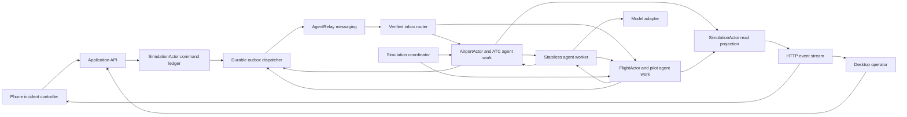

# Multi Airport Agent Simulator Design

**Status:** Handoff specification, written October 31, 2026. User requirements are distinguished from implementation defaults below. The defaults make this document executable; they are proposed decisions, not claims of prior user approval. This is a fictional coordination simulator, not operational aviation software.

**Read with:** [Implementation plan](../plans/2026-10-31-atc-simulator.md). The plan provides files, interfaces, tasks, and acceptance tests. This document defines product behavior and invariants. Build in `atc-simulator/` under the workspace root; preserve other projects and the existing `haunted-hacks-setup/` examples.

## 1. Product and required outcomes

The operator starts a simulation with a chosen number of autonomous flights. Each airport has an ATC agent backed by a Terse durable actor. Flights communicate with ATCs through AgentRelay to obtain landing arrangements. Airport closures cause flights to negotiate diversions. A flight emergency causes the flight to seek an urgent landing at the closest feasible airport. A phone controller creates and resolves incidents by sending commands through AgentRelay. The big screen shows the resulting movement, commitments, refusals, and recovery.

### Explicit user requirements

- Select the number of flights in the simulator.
- Select and trigger different airport and flight emergencies.
- Airport bad weather can prevent all arrivals; affected flights communicate with other ATCs to redirect.
- A flight reporting smoke negotiates with nearby ATCs for an emergency landing.
- Use Terse Durable Actors for airport state and agents, and AgentRelay for communication.
- Both activating and clearing incidents must travel through AgentRelay, including commands initiated on a phone.
- Provide a complete design that another implementer can follow without this conversation.

### Implementation defaults

| Choice | Exact default |
|---|---|
| Working title | Ghost Tower |
| Airports | Three fictional airports: ALP / Alpha, BRV / Bravo, CHR / Charlie |
| Flights | Integer 1–30; default 10; presets 5, 10, 20, 30 |
| Changing flight count | Only when creating a new run; disabled after Start until Reset |
| Flight actors | One durable actor and one logical LLM agent per flight |
| Airport actors | One durable actor and one logical LLM agent per airport |
| Other organizations | Ground/fire readiness represented by airport resources; separate ground, fire, airline, and hospital agents are extensions |
| Simulation geography | Fictional planar map, 240 × 160 nautical miles; no map provider or live data |
| Run lifecycle | CONFIGURING → STARTING → PAUSED → RUNNING → PAUSED or COMPLETED; RESETTING starts a fresh run |
| Time | 250 ms wall-clock scheduler interval; speed choices 1×, 5×, 10×; default 10× |
| Initial seed | 20261031, editable unsigned 32-bit integer before Start |
| Main display | Desktop/tablet observer plus operator controls |
| Phone | Separate responsive incident controller, entered using a QR link |
| Initial deployment | One laptop, persistent local actors and Relay, app reachable over a trusted LAN |
| Durable agent execution | Actors own inbox, work, decisions, and outbox; a stateless worker executes LLM/network I/O |

These defaults bound the hackathon project. Thirty is a supported configuration target, not a measured capacity claim. Performance gates in the plan determine whether it is demo-ready.

## 2. Demo and product scope

The primary demo is: create 10 flights; start; close Alpha due to weather from the phone; observe displaced flights requesting offers from Bravo and Charlie; inject smoke into a selected flight; observe its urgent request, ATC response, and confirmed diversion; clear weather and smoke from the phone; show that conditions recover without rewinding flight movement or confirmed commitments. Finish by restarting the worker and showing durable continuity.

Include six incident types: `WEATHER_CLOSED`, `RUNWAY_CLOSED`, `CAPACITY_REDUCED`, `SMOKE`, `ENGINE_TROUBLE`, `LOW_FUEL`. Every type has an explicit clear operation. Clearing a condition does not erase its history or reverse physical consequences.

Out of scope: real airports or airspace rules, altitude/separation physics, realistic aerodynamics, real ADS-B/weather feeds, voice radio, airline itineraries, passenger simulation, live aircraft control, commercial billing, and multiregion infrastructure. These do not belong in the required implementation.

The initial buyer hypothesis is airport operations teams using incident rehearsal and coordination analysis. The product measures time to acknowledged incident, time to confirmed feasible diversion, refusals, unresolved flights, and successful landings. Do not manufacture monetary savings or “lives saved.”

## 3. Architecture and ownership

Logical agents are actor-owned: their durable memory, decisions, and pending actions live in their respective actors. An external worker performs slow LLM calls against actor snapshots and submits results with revision guards. This preserves the requested durable-agent model without holding an actor mutation open during inference. It is not one omniscient agent impersonating all flights.

### Authorities

| Component | Owns | Must not do |
|---|---|---|
| `SimulationActor` | Run registry, configuration, durable clock/tick, command receipts, public projection, worker lease | Choose destinations or silently broker negotiations |
| `AirportActor` | Local incidents, runways, offers, reservations, landing clearances, ATC work | Modify another airport or a flight's chosen destination |
| `FlightActor` | Position, fuel, flight incidents, negotiation, chosen assignment, pilot work | Grant itself a landing slot or override a closed runway |
| Gateway | HTTP authentication, command validation, read stream | Apply an incident directly to its target |
| Relay adapter | Identity mapping, sending, receiving, durable transport recovery | Treat message text or a delivery receipt as a successful domain operation |
| Worker | Execute leased actor work and dispatch durable outboxes | Keep the only copy of a decision or pending message in memory |
| Simulation engine | Tick progression and physical/safety checks | Replace inter-agent negotiation with direct hidden calls |

Agent-to-agent requests, offers, acceptances, refusals, revocations, clearances, and command results travel through Relay. Internal clock updates, snapshot reads, projection updates, and final touchdown validation may use typed actor RPC. These infrastructure calls are not agent negotiations.

### Alternatives considered

1. **Central orchestration with messages added for display:** smaller, but fails the user's distributed negotiation requirement. Reject.
2. **One interactive coding CLI process per aircraft:** possible, but adds process supervision and transcript overhead for 30 flights. Keep for developer assistance, not the simulator runtime.
3. **Actor-owned agents with the programmatic AgentRelay SDK:** selected for this plan. Separate identities and durable state, bounded model concurrency, and application-controlled simulation execution.

### Implementation stack

- Bun 1.4.4 for installation, server/worker execution, and tests; TypeScript 5.9.3.
- `terse-sdk` and `terse-cli` 0.14.9, matching the local validated example. Import actors from `terse-sdk/actor`; use generated actor clients. Do not mix this package/API with newer repository quickstarts.
- `@agent-relay/sdk` 15.0.0-next.10; lock transitive `@relaycast/sdk` 8.16.0 to match the inspected installation. Explicitly configure its base URL and workspace credentials.
- `openai` 6.26.0 through a small model adapter; `OPENAI_MODEL` is required in live mode and must name an accessible model that supports the selected structured-output API. No model identifier is guessed in source.
- React 19, Vite 7, Zod 4, native SVG, plain CSS, and Lucide icons. Select exact available compatible patch versions at bootstrap and commit `bun.lock`; no floating `latest` at runtime.
- Bun unit/integration tests and Playwright browser tests. No Next.js, map SDK, Redis, extra application database, or orchestration framework.

## 4. World, flight generation, and clocks

### World constants

Airports are `ALP=(50,50)`, `BRV=(110,110)`, `CHR=(170,50)` in nautical miles. Each has runways `R1` and `R2`, each with 60 simulated seconds of exclusive occupancy per landing. Both start open. Each airport has emergency response capability; no hospital routing in v1. A `CAPACITY_REDUCED` incident changes runway occupancy to 120 seconds and closes no runway by itself.

Flight IDs are `F001` through `F030`; visible callsigns are `GHOST 001`, etc. Original destinations cycle ALP, BRV, CHR. Use seeded `mulberry32` with the saved seed; for each flight consume random numbers in this order: angle `2πu`, distance `25+15u` nautical miles, initial fuel `3600+floor(1800u)` simulated seconds. Position is the original destination plus the polar offset. Cruise speed is 240 knots. A run has no continuous spawning; its selected N flights eventually land or end unresolved. Do not remove landed aircraft from the roster.

Normal speed is 240 knots. Engine trouble reduces speed to 180 knots while any engine incident remains active. Fuel burns one unit per simulated second while airborne, including holding, and zero once landed. Reserve is 120 simulated seconds. Euclidean distance determines flight time: `travelSeconds = distanceNm / speedKnots * 3600`.

### Clock behavior

- The coordinator obtains a fenced worker lease for the active run: lease 10 wall seconds, renewal every 3 seconds. Every worker mutation carries the run and lease epoch.
- A tick advances at most 0.25 wall seconds × configured speed. Persist `pendingTick={tickId,fromSimSec,toSimSec,entityIds}` before dispatch. Each entity applies a tick ID once. Complete the tick only after all entities acknowledge; publish the resulting coherent projection afterward.
- Retry an interrupted pending tick with exactly the same ID and target time. Never advance an entity twice. Process airports, then flights, then touchdown attempts; record intermediate receipts so the entire tick is retryable.
- If a required entity is unavailable, keep the tick pending and show `RECOVERING`. No catch-up jump on restart: resume from the last persisted tick, ignoring wall time spent offline.
- Pause stops simulated time, movement, fuel, and incident deadlines. Relay commands, negotiation, acknowledgements, and wall-clock offer expiry continue. State this in the UI.
- Simulation deadlines and runway slots use simulated seconds. Network retries, worker leases, model timeouts, and offer TTL use wall-clock milliseconds. Fields must identify their time domain explicitly.
- A run completes when every flight is `LANDED` or `UNRESOLVED`. Fuel exhaustion or expiry of an active emergency landing deadline makes a flight `UNRESOLVED`; preserve the reason, end its movement, and release its bookings. This is a simulation outcome, not a crash animation.

### Flight movement

Phases are `ENROUTE`, `HOLDING`, `APPROACH`, `LANDED`, `UNRESOLVED`; negotiation is a separate state. Before a confirmed replacement, keep flying toward the last valid destination. If that destination is closed/revoked or no valid assignment exists, enter a six-nautical-mile holding orbit rather than flying into the closed airport. Choose its center as `(currentX-6,currentY)` with initial angle zero so entering holding does not teleport the plane. Capture this center once; advance its angle by `speedKnots/3600/6 * deltaSimSec`. For the orbit around a valid destination, use the airport as center and the current radial angle after reaching the six-NM boundary. The map viewBox may expand to keep a selected holding flight visible near the world boundary; it does not clamp physical coordinates.

With a valid assignment, move toward the airport until six nautical miles away, then hold around the airport. Request final clearance when within six nautical miles and `slotStartSimSec-nowSimSec <= travelSecondsToRunway+120`; the 120 simulated seconds provide communication/model lead time. Receiving clearance early does not start descent/movement to the runway early: remain in the holding orbit until `nowSimSec >= slotStartSimSec-travelSecondsToRunway`, then approach. If current travel would already miss the allowed landing window, renegotiate instead. The engine checks the clearance against current airport state every tick; an invalidated clearance forces holding and a new negotiation. Actual touchdown requires the current airport actor to accept the same clearance ID, matching flight and reservation, within `[slotStartSimSec, slotStartSimSec+30]`. Occupancy starts at actual touchdown and lasts the configured occupancy duration; offers must include the 30-second grace in conflict checks. A missed window expires and triggers renegotiation. No overlapping runway occupancy is permitted.

The authoritative airport touchdown record is written first, idempotently, then the flight is marked landed. If interrupted between those writes, recovery completes the flight transition from the airport receipt. A later closure cannot retroactively undo a recorded touchdown.

## 5. Incident semantics

All incidents have `incidentId`, `runId`, `target`, `kind`, `parameters`, `createdAtSimSec`, `createdAtWallMs`, `createdBy`, `status=ACTIVE|RESOLVED`, optional `resolvedAtSimSec`, and monotonically increasing `revision`. IDs are supplied at creation and reused on retries. A resolved incident cannot be reactivated; a new activation uses a new ID. Keep resolved records for the run.

| Kind | Target and payload | Active behavior | Clear behavior |
|---|---|---|---|
| `WEATHER_CLOSED` | Airport; no parameters | No new arrivals on either runway; revoke pending offers and non-completed reservations/clearances; notify affected flights | Recompute availability; reopen only if no other incident blocks arrivals |
| `RUNWAY_CLOSED` | Airport; `{runwayId}` | Block that runway and revoke its pending arrangements | Reopen that runway only if no other active incident blocks it |
| `CAPACITY_REDUCED` | Airport; no parameters | Occupancy 120 instead of 60 seconds; retain existing protected reservations, schedule new ones with the longer interval | Future offers return to 60 seconds; do not retroactively compress commitments |
| `SMOKE` | Flight; no parameters | Priority EMERGENCY; landing deadline `createdAtSimSec+900`; contact nearest feasible airports | Remove this deadline/priority contribution; preserve route until a replacement is confirmed |
| `ENGINE_TROUBLE` | Flight; no parameters | Speed 180 knots; EMERGENCY; deadline `createdAtSimSec+1200` | Restore speed if no engine incident remains; do not restore burned fuel or position |
| `LOW_FUEL` | Flight; no parameters | On first application only, cap remaining fuel at 900 seconds; derive EMERGENCY priority when fuel ≤900 seconds | Resolve the injected record; actual fuel remains depleted and derived fuel urgency remains while airborne |

For concurrent incidents, combine restrictions: closures are a union; reduced capacity applies if any such incident is active; speed is the minimum imposed speed; deadline is the earliest active deadline; priority is the most urgent condition. Clearing one of two weather incidents must not reopen the airport. Repeating an incident ID with different contents is a conflict, not an update.

Distinguish `commandStatus` from `incidentStatus`: the create command becomes APPLIED while the incident is ACTIVE; the clear command becomes APPLIED while the incident becomes RESOLVED. The phone shows this distinction. “Clear low fuel” explains that clearing the report does not refuel the aircraft. Unknown clear IDs are rejected; repeated clears of a known resolved incident return the original successful resolution.

Apply incident changes in deterministic actor code immediately after validating the Relay command. Do not ask the model whether an authorized operator's weather change is real. The agent then reasons about the resulting operational problem.

## 6. Negotiation and capacity protocol

### Knowledge and objectives

Flights know the public airport directory, latest announced conditions, their own state, and replies sent to them. They cannot read every airport's private booking queue. ATCs know their own state plus request facts supplied by flights. They cannot mutate flight fuel or incidents. Public conditions may be stale, so every offer and acceptance revalidates locally.

Normal flights prefer their original destination while it remains feasible; when that airport refuses or closes, choose the feasible alternative with the earliest offered touchdown, then shortest distance, then airport ID. If an existing diversion is confirmed, keep it unless invalidated or a new emergency demands a better option. Clearing weather is an announcement of availability, not an instruction to return every diverted flight. Emergency flights request all geographically reachable airports (maximum three), then choose the closest feasible accepted offer, breaking distance ties by earlier touchdown, then airport ID. A farther airport wins only if the nearer option is closed, cannot offer an achievable slot before the deadline/fuel reserve, explicitly refuses, or has not replied by the four-second collection deadline. Record a nonresponse as TIMEOUT rather than claiming the airport refused. The model can explain and rank candidates, but cannot violate this selection rule.

### Protocol messages

| Message | Sender → recipient | Required domain fields |
|---|---|---|
| `INCIDENT_CREATE` | Controller → target agent | Complete incident creation input |
| `INCIDENT_CLEAR` | Controller → target agent | incidentId, expectedIncidentRevision |
| `COMMAND_RESULT` | Target → controller | commandId, APPLIED or REJECTED, code, resultingRevision, incidentId |
| `AIRPORT_STATUS` | ATC → flights | airportId, statusRevision, effective restrictions |
| `LANDING_REQUEST` | Flight → ATC | negotiationId, flightId, flightDecisionRevision, position, speed, fuel, sampledAtSimSec, priority, deadlineSimSec or null |
| `LANDING_OFFER` | ATC → flight | negotiationId, offerId, airportId, runwayId, slotStartSimSec, occupancySec, expiresAtWallMs, airportOperationalRevision |
| `LANDING_REFUSED` | ATC → flight | negotiationId, airportId, code, short explanation |
| `OFFER_ACCEPT` | Flight → ATC | negotiationId, offerId, flightDecisionRevision, current flight facts |
| `OFFER_DECLINE` | Flight → ATC | negotiationId, offerId |
| `LANDING_CONFIRMED` | ATC → flight | negotiationId, offerId, reservationId, runwayId, slotStartSimSec, occupancySec |
| `RESERVATION_RELEASE` | Flight → ATC | reservationId, flightId |
| `RESERVATION_REVOKED` | ATC → flight | reservationId, reason, airportOperationalRevision |
| `RESERVATION_STATUS_REQUEST` | Flight → ATC | negotiationId, offerId, reservationId if known |
| `RESERVATION_STATUS` | ATC → flight | matching identifiers, current status, confirmed reservation if one exists |
| `CLEARANCE_REQUEST` | Flight → ATC | reservationId, current flight facts |
| `CLEARANCE_GRANTED` | ATC → flight | reservationId, clearanceId, airportOperationalRevision, valid landing window |
| `CLEARANCE_REFUSED` | ATC → flight | reservationId, code |
| `DOMAIN_ACK` | Recipient → sender | processedMessageId, resultCode |

Success uses code `OK`. Domain rejection/status codes are `CLOSED`, `NO_CAPACITY`, `UNREACHABLE`, `DEADLINE_EXCEEDED`, `OFFER_EXPIRED`, `STALE_STATE`, `WRONG_RUN`, `UNAUTHORIZED`, `INVALID_PAYLOAD`, `UNKNOWN_INCIDENT`, `REVISION_CONFLICT`, `ALREADY_TERMINAL`, `INVALID_LEASE`, `WRONG_PHASE`, `TIMEOUT`, and `NO_FEASIBLE_AIRPORT`. Terminal flight reasons are `FUEL_EXHAUSTED` and `EMERGENCY_DEADLINE`. Use codes for behavior and short text for display.

### Exact booking sequence

1. Flight durably opens a negotiation round. Coalesce reasons occurring within 250 wall ms. A flight has at most one active round and one pending acceptance.
2. Flight agent prepares requests. Normal initial traffic requests its original airport first; on refusal request the other two. Emergency/closure diversion requests all reachable candidates immediately, ordered by distance.
3. Airport agent proposes an eligible offer or a refusal. Actor code validates conditions and allocates a slot, storing an exclusive tentative hold before emitting `LANDING_OFFER`. Duplicate request IDs return the same stored result. One tentative offer per flight/airport/round.
4. Slots start on a 30-second simulated grid, no earlier than `ceil((now+travelSeconds+60)/30)*30`; search up to 1800 simulated seconds ahead. Protect `[slotStart,slotStart+occupancySec+30)` against overlapping offers, confirmations, or occupancy on the same runway. Iterate earliest start, then runway ID. Offer TTL is 20 wall seconds.
5. Collect replies for at most 4 wall seconds. If all candidates have answered, choose immediately. If a closer reachable airport has not answered, wait until the collection deadline before considering farther offers. The model proposes a choice from feasible offers; the actor checks the mandated ranking. A late superior offer does not trigger oscillation after confirmation.
6. Flight persists pending acceptance and sends `OFFER_ACCEPT`. Airport rechecks offer TTL, current restrictions, available runway, deadline, and current reachability; then atomically converts that hold to a confirmation. Do not invalidate merely because unrelated queue entries changed; validate the specific offer and restrictions.
7. Flight switches its single active assignment only after `LANDING_CONFIRMED` and local revalidation. Persist the new assignment and outbox releases for the previous reservation and all unused offers together. During transfer, two airports may temporarily retain reservations; the flight still has exactly one active assignment. Old reservations are cleanup obligations, never alternate active flight routes.
8. If acceptance times out after 5 wall seconds, request reservation status using the same IDs; do not accept elsewhere while the outcome is uncertain. Confirm, reject, or explicitly release the uncertain reservation before starting another round. Retry messages idempotently.
9. When no candidate is feasible, hold, display `NO_FEASIBLE_AIRPORT`, and retry on a material status change or after 5 wall seconds. If fuel/deadline becomes infeasible, terminate as UNRESOLVED with the reason. Never invent an airport or force acceptance.
10. On revocation, discard the affected assignment and open a new round. On a stale late confirmation, schedule its release without overwriting a newer assignment. On a terminal flight, release offers and reservations and reject new incidents.

### Emergency priority

Try a free achievable slot first. If none exists before the emergency deadline, ATC may revoke a normal tentative hold or a normal confirmed reservation whose slot is at least 120 simulated seconds in the future and has no final clearance. Never preempt occupied runway time, a clearance, or another emergency. Choose the earliest eligible slot, then runway ID, then reservation ID. Emit a revocation to the displaced flight and explain why. The displaced flight renegotiates through Relay; do not directly teleport or silently resequence it. On every acceptance and touchdown, hard constraints take precedence over model text.

## 7. Durable delivery, recovery, and model execution

### Envelope

Every protocol message is JSON with `schemaVersion:1`, `messageId` (UUID), `runId`, `fromEntityId`, `toEntityId`, `type`, `correlationId`, `causationId|null`, `createdAtWallMs`, `expiresAtWallMs|null`, and a discriminated `payload`. Incident commands additionally carry `commandId`, `commandSequence`, and a server-issued authorization proof. Max encoded body: 8 KiB. No free-form chat becomes an operational command.

Bind claimed sender to the authenticated Relay sender and registered entity mapping. The controller is the only sender authorized for incident commands. Flight messages can only identify the sending flight; ATC messages can only identify the sending airport. Validate schemas before actor invocation. Reject wrong-run messages; discard outdated condition revisions; retain tombstones for resolved incidents so delayed creation cannot reactivate them.

### Persistence boundaries

Each entity stores its durable aggregate in one persisted state field, replaced rather than mutated in place. One serialized method validates input, computes new state, records the inbox result, and appends outgoing messages. Persist the entire aggregate in that method. Prove the SDK's crash/save behavior in Task 1; do not assume persistence across unrelated actors or network calls. Never use `@Interleave` on a domain mutation.

Outbox entries remain until an application `DOMAIN_ACK` arrives, with retries at 0.5, 1, 2, 4, then every 5 wall seconds. Use the same application message ID and SDK idempotency key on transport retries. Recipient deduplication is keyed by `(runId,messageId)` and stores the result. A duplicate causes the acknowledgement/result to be reissued without repeating the effect. ACKs are not themselves acknowledged; a retried original generates another ACK. Replay must work even if the SDK marks an event delivered before the domain handler finishes.

A repeated send with the same vendor idempotency key may return the existing transport message without delivering another callback. Therefore sender retries alone are insufficient: maintain a durable workspace-event read cursor and reconcile the Relay event log at startup/reconnect and every two wall seconds. Persist a cursor only through the contiguous sequence whose relevant messages have been durably received by their target actors. The observer reads only this application's dedicated workspace and routes by authenticated sender/recipient. WebSocket delivery is a latency optimization; log reconciliation closes gaps. ACKs and results are included in reconciliation. Verify log pagination and callback/commit ordering in the integration probe; never depend exclusively on an SDK in-memory cursor or unread-message badge.

Track `transportMessageId` separately. “Relay accepted” is not “actor applied.” After 15 seconds without a command result, show DELAYED and retain retry/status recovery; do not label an uncertain write definitively failed. Default command expiry is 60 wall seconds; offer acceptance uses the offer TTL. Expired commands that were never applied are rejected. Already-applied duplicate commands still return their successful result. A later result replaces DELAYED.

### Command ordering and clearing

`SimulationActor.submitCommand` deduplicates the client-generated command ID, assigns a per-target sequence, and persists the command/outbox before HTTP returns 202. Dispatch at most one unapplied controller command per target. The target records `lastControllerSequence`; gaps are buffered/retried, not applied out of order. Commands rejected or expired still consume their sequence with a recorded result. This prevents a clear from arriving before its creation. Phone clear buttons are available only once creation has been confirmed and include the incident revision.

Do not discard an expired controller envelope at the sender: deliver it for target-side rejection/sequence consumption, or recover its previously persisted success. Until that outcome is known, keep the receipt DELAYED and later target commands queued. Cleanup/status/ACK/result messages have no application expiry; they remain valid only for their run and identifiers. An unavailable target must not cause the controller to guess whether a command applied.

### Model jobs

Each logical agent owns an actor work queue. `claimWork` returns a job ID, lease token, decision revision, allowed actions, local snapshot, and relevant received messages. Use a 10-second wall lease and a 6-second model timeout; renew work leases for queued long operations, but do not hold a job while waiting for the global model semaphore. Maximum four concurrent model calls and one call per entity. Prioritize flight emergencies, closures, booking replies, then normal arrivals. Bound input to local snapshot plus the latest 12 relevant messages and output to one typed action with a reason of at most 240 characters.

Construct a compact model view, not the raw durable aggregate: omit inbox/outbox/dedup/fencing internals and credentials, include only relevant queue entries and offer facts, and cap each message summary at 512 characters. Cap the serialized decision input at 16 KiB; remove oldest summaries first, never required operational facts. If the remaining required facts cannot fit, use the rules policy and log INPUT_TOO_LARGE. Lease metadata stays in the worker and is not sent to the model.

Model outputs are proposals: `REQUEST_LANDING`, `SELECT_OFFER`, `PROPOSE_OFFER`, `REFUSE`, `HOLD`, or `REQUEST_CLEARANCE`. The actor checks the action is allowed for the job and that its decision revision is current. Movement ticks do not invalidate every model job; keep `decisionRevision` separate from `stateRevision`. Recheck moving position, fuel, and arrival feasibility at commit time. Incident changes and reservation changes do invalidate decision work.

If a response times out, is malformed, or violates the deterministic rules, record the reason and use the deterministic policy for that action. Mark the UI event `RULES_FALLBACK`; never present fallback as a live model decision. Unit/E2E tests use `AGENT_MODE=rules`. The final demo must also pass with `AGENT_MODE=live` and show actual model decisions by at least one pilot and one ATC.

Never store or display private chain-of-thought. Display the short decision reason and the actual protocol messages. Do not let model text supply arbitrary actor method names, recipient identities, or executable code.

### Recovery

On worker start: acquire a new fencing epoch; load active run, unfinished tick, entity registry, actor jobs, and outboxes; reconnect existing Relay identities using saved tokens; resume pending tick; reconcile pending acceptances/landings; restart subscriptions; replay unacknowledged messages. Re-registering an existing name is not reconnection. Credentials live in a server-only persistent file, mode 0600; retain the credential and base-URL binding. Public actor state and SSE never contain tokens.

Reset creates a new run ID and actor namespace. Fence the previous run before activating the new one. Old messages, model results, timers, and outbox entries cannot mutate the new run. Preserve previous run data for inspection; no global deletion or token rotation of unrelated identities. Limit retained runs to manual cleanup outside the demo path.

## 8. HTTP, live view, and phone access

Routes:

| Route | Permission | Behavior |
|---|---|---|
| `GET /` | Viewer | Main display |
| `GET /control` | Controller session | Phone controls |
| `POST /api/join` | One-time QR capability | Exchange capability for scoped HttpOnly session cookie |
| `POST /api/runs` | Operator | Create run from flightCount/seed; idempotent client request ID |
| `POST /api/runs/:runId/start` | Operator | Finish initialization and start simulation |
| `POST /api/runs/:runId/pause` | Operator | Pause movement/time |
| `POST /api/runs/:runId/resume` | Operator | Resume |
| `POST /api/runs/:runId/speed` | Operator | Set one of 1, 5, 10 |
| `POST /api/runs/:runId/reset` | Operator | Fence old run and return fresh configuring state |
| `POST /api/runs/:runId/commands` | Controller or operator | Persist/enqueue incident command; return 202 and commandId |
| `GET /api/runs/:runId/commands/:commandId` | Viewer with run access | Authoritative command receipt |
| `GET /api/runs/:runId/snapshot` | Viewer with run access | Full public snapshot with projectionVersion |
| `GET /api/runs/:runId/events` | Viewer with run access | SSE full public snapshot at up to 4 Hz, plus command updates |
| `POST /api/runs/:runId/controller-invites` | Operator | Mint one-time phone join link; expires after 15 wall minutes |
| `GET /api/health` | Public | Redacted readiness of app/actors/Relay/model configuration |

Creating a run does not start movement until identities and actor initialization succeed. Use an initialization saga so retrying Start resumes setup rather than making another set of flights. Return 400 for invalid schemas, 401/403 for missing/incorrect role, 404 for unknown run/entity, 409 for wrong run phase or reused ID with changed contents, and 429 for rate limits. Incident business rejection after enqueue is a command result, not a fabricated successful HTTP write.

Each SSE frame has a monotonic projection version and run ID. At this scale send full snapshots rather than complicated browser patches. A reconnect starts with the newest snapshot; no event-history gap can corrupt the browser state. Keep at most 200 visible timeline entries, with server-side paging for the full run log. Display connection freshness; after two wall seconds without a frame show Reconnecting and do not animate beyond the last authoritative sample.

Mint a 32-byte random QR join capability, put it in the URL fragment, exchange it with POST, then remove the fragment. The session grants incidents for the named run, not reset/configuration rights. Require same-origin requests and a CSRF token for mutations. Cap controller commands at five per wall second per session and 20 per second per run. The gateway attaches the trusted command identity/proof; never trust a browser-supplied sender or priority.

Use a single application origin on the LAN, e.g. `http://<laptop-lan-ip>:3000`. Bind the public app listener deliberately; keep Terse and Relay listeners on loopback. For an internet deployment, use HTTPS with Secure cookies. Never expose model keys, Relay tokens, or an unauthenticated actor endpoint to the phone. Invite tokens are not written to analytics/access logs.

## 9. Interface specification

Use Impeccable as the primary design workflow, frontend-ui-engineering for implementation, and Emil design engineering for motion polish. The brief below takes precedence over optional aesthetic skill defaults. No decorative scanlines, fake telemetry, CRT flicker, or unreadably small text.

### Desktop at 1440 × 900

- A 64 px top bar: Ghost Tower, run status, simulated time, speed, Pause/Resume, Reset, connection indicators, Phone controls QR button.
- A 280 px left panel: configuration before Start; flight list during a run. Search by callsign, filter All/Emergency/Negotiating/Landed/Unresolved. Show callsign, destination, urgency icon/text, and fuel minutes.
- A center map occupying remaining space. SVG viewBox `0 0 240 160`, north-up, consistent scale. Airport marker labels include code, Open/Restricted/Closed, and confirmed queue length. Aircraft are heading-oriented triangles with callsigns. Select with click or keyboard list navigation.
- A 340 px right panel: selected airport/flight, current incidents, allowed trigger buttons, commitments and relevant negotiation transcript. Empty state says “Select an aircraft or airport.”
- A 180 px bottom timeline under the map: event time, sender → receiver, message summary, and APPLIED/REFUSED/PENDING status. Filters for selected entity and all activity. It must not grow the page with every message.
- At 1024 px, collapse the left list to a drawer. Below 768 px, show a focused entity list/map toggle; the dedicated phone controller remains the preferred control surface.

Visual tokens: background `#10161C`, panels `#18222C`, primary text `#F3F6F8`, secondary `#A9B7C4`, borders `#344553`, normal routes `#58C8DD`, warnings `#F0B35C`, emergencies `#F07178`, recovered/confirmed `#7DD6A2`. Use system sans-serif for UI and a bundled/system monospace for callsigns and clocks. Body 14–16 px desktop, 16 px phone; touch controls at least 44 × 44 px. Pair every color with a label/icon. Visible focus, keyboard operability, and reduced-motion support are required.

Route semantics: confirmed route solid; proposed offer dashed; revoked route briefly crossed out then removed; closed airport labeled and hatched. Rendered movement interpolates between authoritative samples; interpolation never mutates simulation state. A selected entity stays selected as it updates. Sort stable lists by callsign, not by moving position.

### Phone at 390 × 844

- Top: run name, live/reconnecting status, current active incident count.
- Tabs: Airports, Flights, Active incidents.
- Airport card opens local status and three incident choices. Runway closure requires choosing R1 or R2.
- Flight list has search and urgency badges; detail provides Smoke, Engine trouble, and Low fuel.
- Trigger action immediately shows a pending command row and disables that command's duplicate button. On acknowledgement, show the active incident; on rejection, show its reason and retry only where meaningful.
- Active incident cards have one explicit “Resolve incident” control and show target, type, applied time, and current status. Do not offer an ambiguous global “remove all” action.
- Clearing low fuel includes the persistent note “Resolves the report; remaining fuel does not increase.”
- An expired/reset run disables controls and offers return to the current run's join screen. A controller cannot silently affect a new run with an old session.

### Operator configuration

Flight count number input and slider share validation 1–30; seed input has a visible default; Start remains disabled on invalid values or missing dependencies. Display exact configured flight/ATC counts. Once Start begins, lock configuration. Reset confirms the new-run action in the product UI because it ends the current scenario; it preserves historical records. The judge's controller cannot reset the run.

## 10. Deployment, validation, and delivery

Local services: actor runtime on loopback 7100, dedicated project Relay engine/workspace on loopback 8787 or a separately configured available port, app server on 3000, Vite on 5173 only during development. Ports must be checked before startup; never terminate an unrelated service to reclaim one. `bun run dev` supervises this project's server/worker/frontend and connects to explicitly configured actor/Relay services. `bun run start` serves the built frontend and API, with a separately supervised worker. Provide `bun run doctor`, `bun run actors:generate`, `bun run check`, `bun test`, `bun run test:integration`, `bun run test:e2e`, `bun run test:live`, and `bun run demo:reset`.

Save actor data, Relay identity tokens, and run metadata under ignored persistent project directories. Document a single-VM deployment with the same processes, persistent disk, reverse proxy HTTPS, and restart policies; external hosting is optional for the hackathon because a LAN-connected phone meets the interaction requirement. Do not deploy a stateful worker to an ephemeral request-only serverless runtime.

Acceptance requires real Terse persistence and real Relay transport. A mock-only demo is not complete. Readiness targets at 10 flights: controller command application p95 ≤2 wall seconds with healthy Relay; full diversion commitment p95 ≤12 wall seconds with configured live model; browser input remains responsive. At 30 flights, no lost commands, double bookings, or unbounded model queues. Record achieved numbers and failures instead of claiming these targets were met without measurement.

Required test scenarios: normal landing; total airport closure; smoke selecting closest feasible airport; concurrent diversions; emergency priority with displaced normal flight; overlapping incidents and individual resolution; clear low fuel without refueling; duplicate/out-of-order commands; lost confirmation; expired offers; closure during approach; all airports unavailable; model failure fallback; worker restart during apply/send and pending touchdown; browser reconnect; reset with in-flight messages; phone access controls; 1/10/30 flights.

## 11. Verified starting context and references

Local setup notes in `haunted-hacks-setup/README.md` record separate successful counter persistence and Relay message/ack probes. They do not demonstrate the integrated simulator or autonomous flight reasoning. No simulator code has been created as part of writing this specification.

Inspected on October 31, 2026:

- [Hackathon brief](https://events.ycombinator.com/haunted-hacks-2026): five-hour build window, live demos, and use of Terse/AgentRelay. All code is to be created at the hackathon; planning beforehand is allowed.
- [Terse quickstart](https://docs.useterse.ai/quickstart) and [TypeScript reference](https://docs.useterse.ai/reference/typescript-sdk): actor fields, generated clients, state emission. Match the installed 0.14.9 API in the local example.
- [AgentRelay repository](https://github.com/AgentWorkforce/relay) and [Relaycast API reference](https://agentrelay.com/docs/relaycast-api): messaging capabilities and engine relationship.
- Local `haunted-hacks-setup/tools/node_modules/@agent-relay/sdk/README.md`, `dist/agent-relay.d.ts`, and `dist/facade.d.ts`: programmatic client, live registered identities, reconnect, listener API, and idempotency keys.
- Local `haunted-hacks-setup/counter-local/actor/src/actors.ts` and actor README: pinned decorator imports, actor generation, and local runtime commands.

The coding assistant's desktop Relay identity is separate from application identities. This planning session sends no peer messages. An implementer coordinating with other coding sessions must obey that session's prescribed local Relay socket route; do not reuse unrelated human/coding sessions as simulated pilots.
